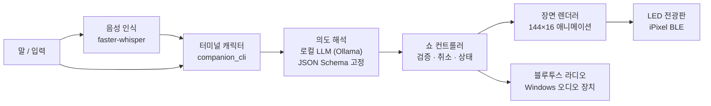

<div align="center">


**말 한마디로 집 안의 옛날 기기를 부리는 터미널 속 AI**

[로드맵](ROADMAP.md) · [왜 돈이 되는가](docs/BUSINESS.md) · [브랜드](docs/BRAND.md) · [기여 안내](CONTRIBUTING.md)


<sub>위 화면은 실제 전송 코드가 만든 144×16 프레임을 LED 점 모양으로 확대한 것입니다.</sub>

</div>

---

## 한 문장 소개

> **“크리스마스 분위기 내줘.”** 라고 말하면, 터미널 속 AI가 대답하고 **133cm LED 전광판**에 산타와 기차가 달리며 **오래된 블루투스 라디오**에서 캐럴이 흘러나옵니다.

집에는 앱도, 클라우드도, API도 없는 물건이 가득합니다. 블루투스로만 말하는 전광판, 라디오, 리모컨 하나로 움직이는 장난감 기차가 그렇습니다. 스마트홈은 이런 물건을 버리고 새로 사라고 합니다. **Kevin는 반대로 갑니다.** AI가 기존 물건의 통신법을 쥐고, 사람의 말을 그 기기의 언어로 바꿔 직접 부립니다.

## 시연 장면

<table><tr><td></td><td></td></tr><tr><td align="center"><sub>방을 서성이는 AI</sub></td><td align="center"><sub>말을 걸면 다가와 듣는다</sub></td></tr></table>

```
┌──────────────────────────────────────────────────────────┐
│  (도트 그래픽의 방, AI 캐릭터가 서성인다)                    │
│                                                          │
│  [Space]  →  배경이 사라지고 캐릭터가 크게 다가온다           │
│                                                          │
│  > 산타가 날아다니게 해줘. 눈은 펑펑, 캐럴도.                 │
│                                                          │
│  「눈을 많이 내리고, 산타 장면으로 바꿀게. 캐럴도 틀어줄게.」   │
│        │                         │                       │
│        ▼                         ▼                       │
│   LED 전광판 (BLE)          블루투스 라디오 (A2DP)          │
└──────────────────────────────────────────────────────────┘
```

1. 터미널에서 `./kevin --live` 를 실행합니다. 90년대 PC 게임처럼 색이 있는 도트 화면에서 AI 캐릭터가 방을 걷습니다.
2. **Space**를 누르면 배경이 사라지고 캐릭터가 화면 가득 다가와 말을 기다립니다.
3. 한국어로 말하거나(**Ctrl+V** 녹음) 입력합니다. 예: “기차 더 빨리”, “하늘을 보라색으로”, “음악은 꺼줘”.
4. AI가 요청을 **허용된 동작의 계획**으로 바꾸고, 전광판과 라디오가 동시에 바뀝니다.
5. **Esc** 한 번이면 모든 기기가 멈춥니다.

## 무엇이 다른가

| | 기존 스마트홈 | Kevin |
|---|---|---|
| 대상 기기 | 회사 앱·클라우드에 등록된 신제품 | 이미 집에 있는 블루투스·적외선 기기 |
| 연결 방식 | 제조사 클라우드 경유 | PC가 기기 통신법으로 **직접** 전송 |
| 명령 방식 | 앱 버튼, 정해진 음성 명령 | 자유로운 한국어 문장 → 검증된 계획 |
| 여러 기기 | 기기마다 따로 | 한 문장이 화면·소리를 **한 장면**으로 묶음 |
| 인터페이스 | 대시보드 | 대화하는 캐릭터가 있는 터미널 |

## 구조



AI가 기기를 마음대로 조작하지 않도록 경계를 두었습니다.

- **가벼운 모델 + 단어 보정.** 노트북에서 도는 qwen2.5 3B가 문장을 0.5초 안에 해석합니다. 작은 모델은 “보라색”을 다른 색으로, “산타”를 기차로 바꾸는 식으로 흔들리기 때문에, 문장에 실제로 나온 단어(색 이름, 산타·기차, 눈, 음악, 전부 멈춰)가 모델 판단보다 우선합니다. 문장에 없는 항목은 바뀌지 않습니다.
- **언어 모델은 계획만 만듭니다.** 출력은 JSON Schema로 고정되어 장면, 속도, 눈, 하늘색, 음악, 볼륨만 바꿀 수 있습니다. 지원하지 않는 요청은 `unsupported`로 돌려보내고 일부만 몰래 실행하지 않습니다.
- **기기 조작은 컨트롤러만 합니다.** 계획을 다시 검증한 뒤 장면을 그려 보내며, 실행 중 새 요청이나 Esc가 오면 이전 작업을 취소합니다.
- **기본은 미리보기입니다.** `--live`와 기기 주소를 함께 지정했을 때만 실물로 내보냅니다.

## 사용한 오픈소스와 기술

| 영역 | 사용 기술 |
|---|---|
| LED 전광판 전송 | [pypixelcolor](https://github.com/lucagoc/pypixelcolor) 0.5.0 (iPixel Color BLE 프로토콜), [Bleak](https://github.com/hbldh/bleak) |
| 통신 규약 참고 | [go-ipxl](https://github.com/yyewolf/go-ipxl), [ha-ipixel-color](https://github.com/cagcoach/ha-ipixel-color) |
| 의도 해석 | [Ollama](https://ollama.com) 로컬 모델 + JSON Schema 구조화 출력 |
| 음성 인식 | [faster-whisper](https://github.com/SYSTRAN/faster-whisper) (선택) |
| 장면·도트 렌더링 | [Pillow](https://python-pillow.org) |
| 라디오 재생 | Windows Runtime `MediaPlayer` + 블루투스 오디오 장치 지정 |

## 실행

기존 전광판·라디오 외 기기는 [기기 프로필](docs/DEVICE_PROFILES.md)로 등록합니다.
직접 WLED와 선택형 Home Assistant 스위치·학습 IR 예제를 제공합니다.
10개 트랙별 확장안과 공통 실행기의 범위는 [유즈케이스 정렬](docs/USE_CASE_ALIGNMENT.md)을 참고하세요.

Python 3.10 이상이 필요합니다.

```sh
python3 -m venv .venv
.venv/bin/pip install -r requirements.txt
./kevin            # 미리보기: 기기를 건드리지 않습니다
```

실물 기기로 내보내려면 Windows에서 다음을 설정합니다.

```powershell
py -m venv .venv
.venv\Scripts\pip install -r requirements-live.txt
$env:KEVIN_LED_ADDRESS = "<전광판 BLE 주소>"
$env:KEVIN_RADIO_DEVICE = "<블루투스 라디오 장치 이름>"
$env:KEVIN_OLLAMA_MODEL = "qwen2.5:3b"   # 가벼운 모델 + 단어 보정
.\kevin.cmd --live
```

| 키 | 동작 |
|---|---|
| Space | 캐릭터에게 말 걸기 |
| Enter | 요청 보내기 |
| Ctrl+V | 음성 녹음 시작/끝 (`KEVIN_ASR_URL` 설정 시) |
| Ctrl+L | 미리보기 ↔ 실물 전환 |
| Esc | 모든 기기 정지 |
| Ctrl+C | 종료 |

음성 인식 서버는 `src/local_asr_server.py`를 `requirements-voice.txt` 환경에서 실행합니다.

## 검증

```sh
PYTHONPATH=src python3 -m unittest discover -s tests
```

99개 테스트가 의도 해석 스키마, 장면 렌더링, 전광판 전송 계획, 취소·정지, 음성 업로드 경계, 터미널 화면을 확인합니다. 실물 BLE·오디오 장치가 필요한 10개는 장치가 없으면 건너뜁니다.

## 실물 검증 상태

정직하게 구분해 둡니다.

| 기기 | 상태 |
|---|---|
| 디라이브 133×19.2cm LED 전광판 (iPixel Color, 144×16) | 행사장에서 한국어 문장 → AI 계획 → 애니메이션 재생까지 눈으로 확인 (해석 약 1초, 전송 약 6초). 전광판은 긴 GIF를 첫 장면만 보여 주므로 12프레임 이하로 자동 축소 |
| 코비 CRF-35B 블루투스 라디오 | 캐럴 재생 청취 확인 |
| MYKA FORT 90995 리모컨 기차 | 리모컨이 적외선 방식임을 확인. 적외선 송신 경로 연결 진행 중 |

## 로드맵 — 집 전체로

같은 원리로 10개 기기 트랙을 팀원이 동시에 개발합니다. 트랙별 시연, 출발점 오픈소스, 완료 기준은 [ROADMAP.md](ROADMAP.md)에 있고 GitHub 이슈로 나뉘어 있습니다.

| # | 트랙 | 시연 한 장면 |
|---|---|---|
| 01 | LED 전광판 | “크리스마스 분위기 내줘” → 산타와 기차가 달린다 **(실물 동작)** |
| 02 | 조명 | 진열이 바뀌어도 카메라로 보고 밝기·위치를 다시 맞춘다 |
| 03 | 스피커·라디오 | 발표가 시작되면 음악은 말소리 아래로, 전광판은 ‘발표 중’ |
| 04 | 월패드 | 다른 등은 그대로 두고 원하는 등만 켠다 |
| 05 | TV | 엉뚱한 화면을 아까 보던 화면으로 되돌린다 |
| 06 | 적외선 가전 | 리모컨 신호를 배워 기차·선풍기를 말로 부린다 |
| 07 | 로봇청소기 | 카메라로 본 남은 구역만 다시 청소한다 |
| 08 | 방범·현관 | 어두우면 불을 켜고 다시 보고 확인한다 |
| 09 | 서비스 끝난 기기 | 서버가 사라진 기기를 다시 살린다 |
| 10 | 모르는 통신법 | 설명서 없는 기기의 명령 의미를 관찰로 배운다 |

## 왜 돈이 되는가

헤이홈 같은 IR 허브가 누적 약 68만 대 팔릴 만큼, 옛날 기기를 스마트하게 쓰려는 수요는 이미 있습니다. 기존 제품은 기기마다 앱과 클라우드에 묶이고, Kevin는 여러 기기를 말 한마디로 묶어 직접 부립니다. 국내 가구의 1%가 월 4,900원을 내면 연 약 136억 원입니다. 가정과 출처는 [BUSINESS.md](docs/BUSINESS.md)에 있습니다.

## 팀

OBA.RUN 2nd 해커톤 출품작입니다.
