<div align="center">

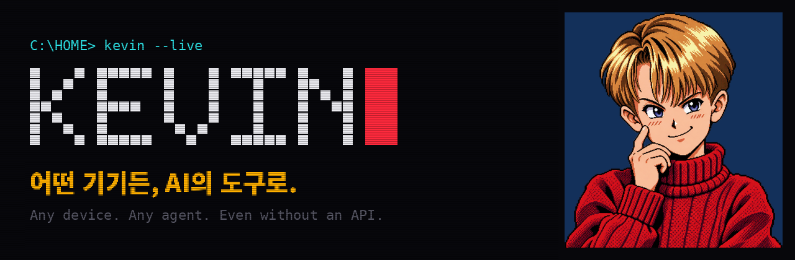

# KEVIN — 이제 백수의 일자리까지 위험합니다

현재 LED·라디오 실물, 다른 기기는 가상 검증 중인 프로토타입입니다.

### 자택경비원부터 굴삭기까지. AI가 API 없던 옛날 기기의 API를 스스로 얻어, 직접 보고 움직입니다.

세상을 보는 VLM 에이전트 · 앱도 API도 없는 기기를 AI의 손으로

**[웹에서 케빈 만나기](https://sergiobuilds.github.io/kevin/)** · [로드맵](ROADMAP.md) · [사업성](docs/BUSINESS.md) · [브랜드](docs/BRAND.md)

</div>

---

## 케빈이 하려는 일

**KEVIN은 VLM(비전·언어 모델)으로 현실을 보고 판단해, API가 없는 기기까지 AI의 손으로 만드는 물리 세계 실행 계층입니다.**

AI는 글을 쓰고 코드를 짜고 웹을 다루지만, 세상에 이미 깔린 기기 앞에서는 손이 없습니다. 공장의 오래된 패널, 병원의 모니터, 아파트의 승강기, 매장의 간판, 농장의 펌프는 리모컨·블루투스·배선으로만 말하고 대부분 API가 없습니다. 케빈은 세 가지를 합니다.

1. **본다 (VLM).** 카메라로 장면과 기기 화면을 읽고, 사람이 왔는지·화면이 바뀌었는지·기계가 이상한지 이해합니다.
2. **부린다 (기기 연결).** 기기의 원래 통신법을 찾아 AI가 부를 수 있는 MCP 도구로 엽니다. 모르는 기기는 신호를 보내 보고 카메라로 결과를 관찰해 명령의 뜻을 스스로 배웁니다.
3. **확인한다 (실물 실행 증명).** 기기의 “받았다”는 대답 대신, 실제로 일어난 변화를 카메라로 관측해 서명된 증명으로 남깁니다.

**KEVIN은 실물 세계를 위한 에이전트 실행 계층입니다.** API가 없는 기기를 MCP 도구로 바꾸고, 실행 결과를 카메라로 관측해 서명된 **실물 실행 증명**을 남깁니다. 연결 하나는 같은 기기를 가진 모든 사람과 모든 에이전트가 다시 씁니다. 새로 사지 않아도 세상이 AI에게 열립니다(2022년 전 세계 소형 가전 폐기물 2,040만 톤, 공식 재활용 12% — Global E-waste Monitor 2024).

| 단계 | 하는 일 | 지금 |
|---|---|---|
| 1. 알려진 기기를 AI의 도구로 | 공개된 통신법으로 기기를 MCP 도구로 열고, 대화 한마디에 여러 기기를 한 장면으로 | **실물 동작.** 133cm LED 전광판·블루투스 라디오를 행사장에서 대화로 제어 |
| 2. 모르는 통신법을 스스로 발견 | 신호를 보내 보고 VLM으로 관찰해 명령의 의미를 학습 | 시뮬레이터에서 RGB 명령 의미 학습 성공 |
| 3. 물리 세계 실행 계층 | 어떤 에이전트든 세상의 기기를 부르고 실물 실행 증명을 받음 | MCP 서버·서명 증명 구현, VLM 침입 판단 동작 |

<table><tr>
<td width="34%">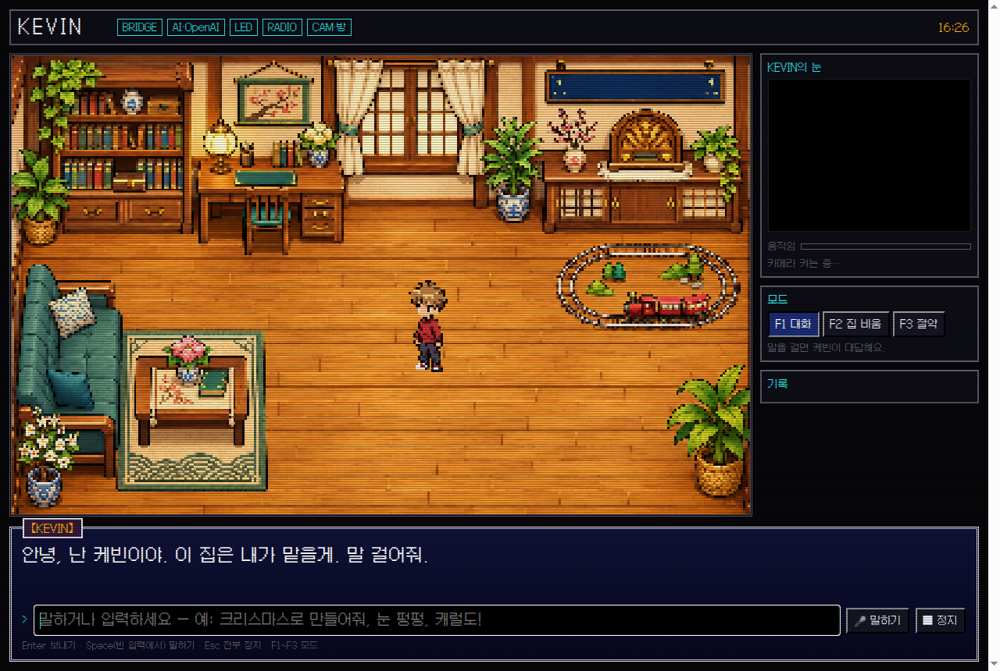</td>
<td width="33%">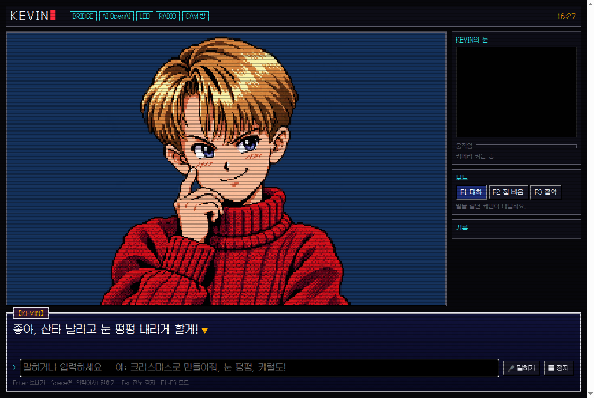</td>
<td width="33%">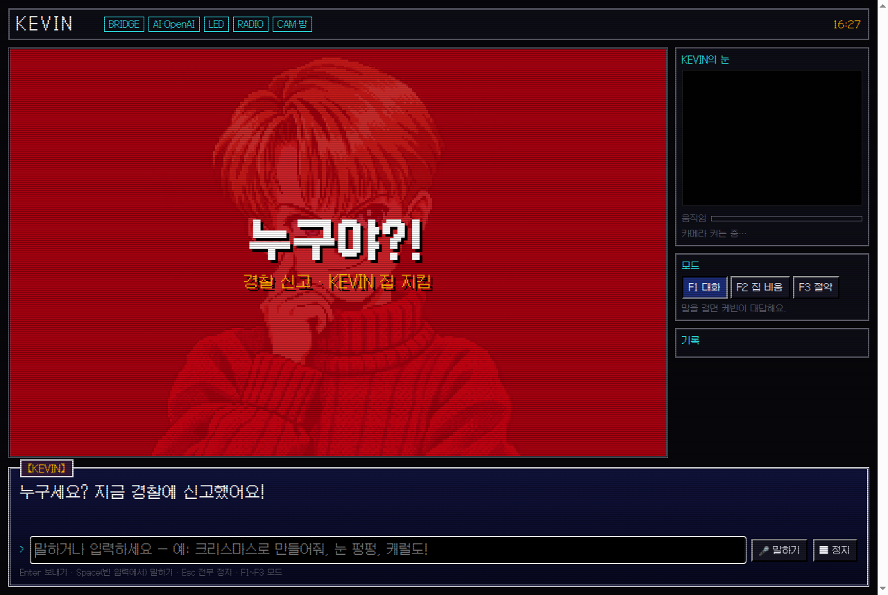</td>
</tr><tr><td align="center"><sub>방을 서성이는 케빈</sub></td><td align="center"><sub>말을 걸면 대답하고 기기를 부림</sub></td><td align="center"><sub>VLM이 사람을 보고 스스로 경보</sub></td></tr></table>

## 케빈이 일할 곳 — 여섯 장면

오늘 실물로 동작한 것은 집의 LED 전광판과 라디오입니다. 아래 여섯 장면은 같은 방식(본다 → 부린다 → 확인한다)으로 넓혀 갈 곳입니다.

### 1. 산업 현장

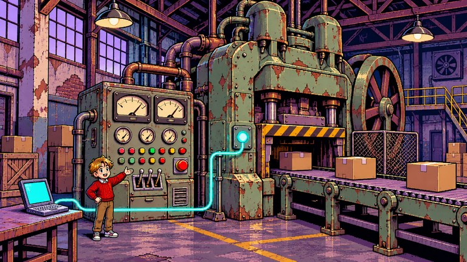

- **지금:** 수십 년 된 기계는 버튼과 아날로그 게이지로만 말합니다.
- **케빈:** 카메라로 게이지 바늘과 경고등을 읽어(VLM) 이상 징후를 찾고, 작업자가 “3번 라인 멈춰” 하면 허가된 동작만 실행한 뒤 실제로 멈췄는지 확인합니다.

### 2. 두더지 게임 · 오락실

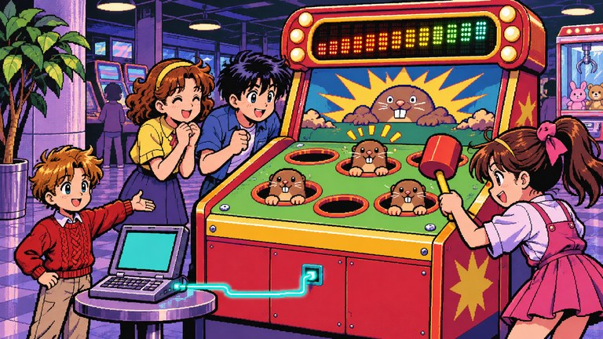

- **지금:** 오래된 오락기에는 화면도 점수 기록도 없습니다.
- **케빈:** 케빈이 진행자가 되어 말로 게임을 시작하고, 카메라로 판을 보며 점수를 세고, 전광판 점수판과 효과음으로 분위기를 띄웁니다. 오늘 전광판 가위바위보·퀴즈 점수판으로 시연했습니다.

### 3. 의료기기 모니터링

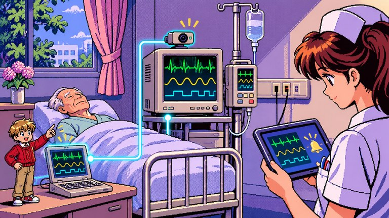

- **지금:** 연동 API가 없는 구형 환자 모니터가 많습니다.
- **케빈:** 기기는 건드리지 않고, 카메라가 모니터 화면을 읽어(VLM) 수치 변화를 간호사 태블릿에 알립니다. 안전을 위해 조작이 아니라 관측과 알림만, 사람의 판단 아래에서.

### 4. 엘리베이터

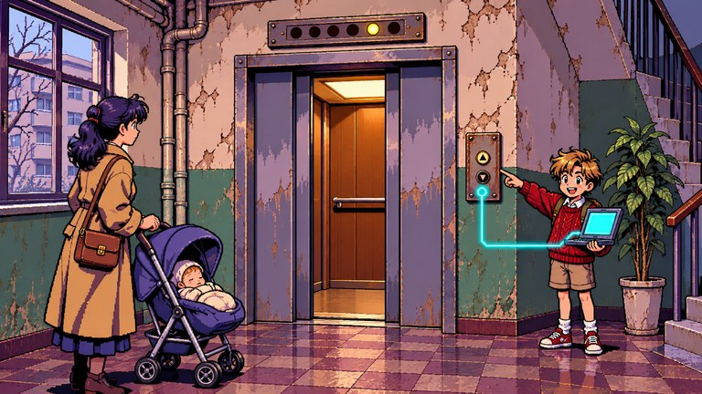

- **지금:** 오래된 아파트 승강기는 교체가 비쌉니다.
- **케빈:** 패널을 뜯지 않고 카메라로 층 표시를 읽어 유모차·어르신에게 도착을 안내하고, 승인된 경우에만 호출합니다.

### 5. 매장


- **지금:** 간판·스피커·조명을 따로따로 조작합니다.
- **케빈:** “오늘 비 오니까 따뜻한 분위기로” 한마디에 간판 문구와 음악을 함께 바꾸고, 카메라로 실제 간판이 바뀌었는지 확인합니다. 오늘 시연한 장면 그대로입니다.

### 6. 스마트팜

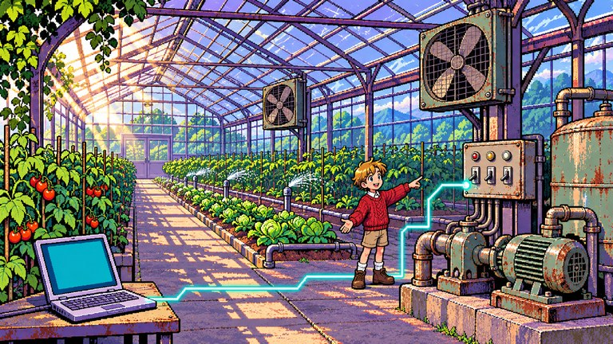

- **지금:** 옛날 펌프와 환풍기는 스위치로만 켜고 끕니다.
- **케빈:** 카메라로 잎 상태와 온습도계를 읽고 펌프·환풍기를 상황에 맞게 켜고 끄며, 아무도 없으면 스스로 절약합니다.


## 제품과 검증 근거

[KEVIN 랜딩페이지](https://kevin-landing-sable.vercel.app/)에서 실제 사용 장면과 기술 구조를 볼 수 있습니다.

[랜딩페이지 소스](docs/landing/index.html)에서 사용 장면과 실행 구조를, [기술 검증 문서](docs/TECHNICAL_EVIDENCE.md)에서 기능별 주장과 소스·검사·한계를 확인할 수 있습니다. [기계 판독용 근거](docs/landing/evidence.json)와 [텍스트 요약](docs/landing/llms.txt)도 같은 사실을 제공합니다. LED 실물 동작 이력, 로컬 프로토콜 데모, 구현과 향후 계획을 구분합니다.

## AI에게는 손이 없다

AI 에이전트는 웹과 API 앞에서는 무엇이든 합니다. 그런데 현실의 기기 대부분에는 API가 없습니다. 리모컨 하나로 움직이는 가전, 블루투스로만 말하는 간판, 벽 속의 월패드, 회사가 서버를 닫은 기기가 그렇습니다. 에이전트는 이 앞에서 멈춥니다.

**KEVIN은 AI가 세상의 옛날 기기를 직접 쓸 수 있게 해 주는 기기 연결 계층입니다.** 기기의 원래 통신법을 찾아 AI가 부를 수 있는 도구로 엽니다. 실물 MCP 경로는 기기를 조작하고, 카메라 촬영·서명이 성공하면 실행 전후 사진을 묶은 **영수증**을 돌려줍니다. 터미널·웹 일반 대화에는 이 영수증이 자동으로 붙지 않습니다.

## 기기의 대답과 실제 세상은 다르다

오늘 행사장에서 전광판은 32프레임 애니메이션을 “받았다”고 대답했습니다. 그런데 화면은 첫 장면에서 멈춰 있었습니다. 기기의 대답만 믿는 지금의 IoT와 에이전트 도구는 이런 실패를 모릅니다.

KEVIN은 기기의 대답 대신 **카메라가 본 변화**를 돌려줍니다. 화면이 바뀌었는지, 애니메이션이 실제로 움직이는지 숫자로 남기고, 사진과 함께 서명합니다. 영수증은 영상 변화와 첨부 기록의 무결성을 확인합니다. 요청 의미·소리·외부에서 신뢰한 서명자 신원은 별도이며, 실물 웹캠 검증은 진행 중입니다.

## 세 층

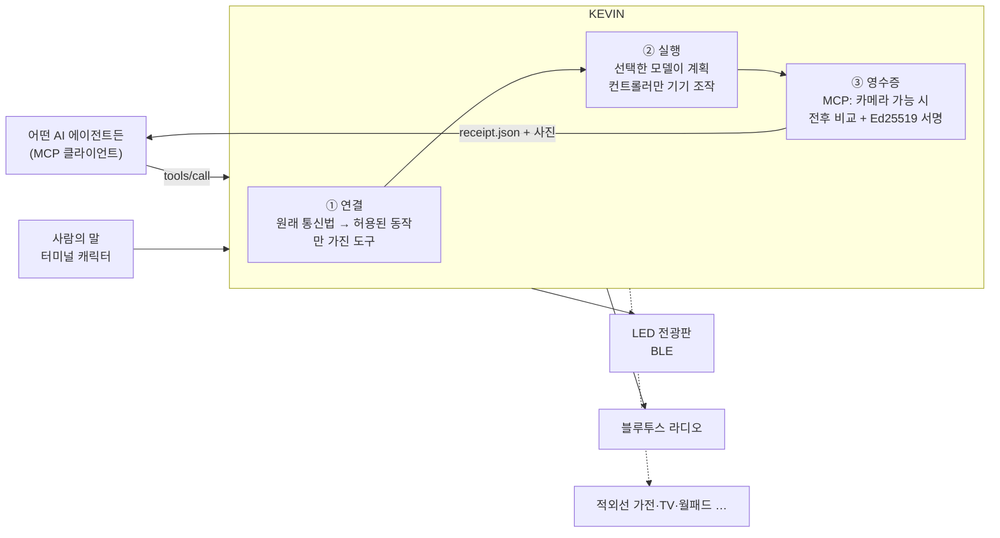

| 층 | 하는 일 | 지금 |
|---|---|---|
| ① 연결 | 오픈소스와 신호에서 기기의 통신법을 찾아, AI가 바꿀 수 있는 항목만 가진 MCP 도구로 엽니다. 선언하지 않은 동작은 기기에 닿지 않습니다. | LED 전광판·라디오 도구 동작. MCP 서버 `src/kevin_mcp.py` |
| ② 실행 | 선택한 모델이 말을 계획으로 바꾸고, 문장에 실제로 나온 단어로 보정합니다. 검증된 계획만 컨트롤러에 전달하며 새 요청·Esc는 취소를 요청합니다. 연결 조건은 아래 경로별로 다릅니다. | 행사장에서 전광판 실물 동작 |
| ③ 영수증 | 실물 MCP에서 촬영·서명이 가능하면 실행 전 1장, 후 2장을 찍어 바뀐 정도와 움직임을 재고, 계획·기기 응답·사진 해시를 묶어 Ed25519로 서명합니다. 사진을 바꿔치기하거나 값을 고치면 바로 드러납니다. | 구현·테스트 완료. 실물 웹캠 연결 진행 중 |

### 실행 경로와 연결 조건

| 경로 | 모델·서비스 | 인터넷·키 조건 | 확인 범위 |
|---|---|---|---|
| 터미널 / MCP `say` 기본 | Ollama `qwen2.5:3b` (`src/show_intent.py`) | Ollama와 모델을 미리 설치하고 로컬 주소를 쓰면 계획 생성에 인터넷·API 키 불필요. 원격 Ollama 주소를 설정하면 해당 서버 연결 필요 | 코드·자동 테스트. 모든 기기에서의 응답 시간 보장 없음 |
| 터미널 / MCP `say`에서 명시적 OpenAI 선택 | 기본 `gpt-6-luna` (`src/openai_planner.py`) | 인터넷·`OPENAI_API_KEY` 필요. 키만 넣어서는 선택되지 않음 | API 모의 응답 테스트. 이 변경의 유료 API 실호출 미검증 |
| 웹 대화 | 기본 `gpt-5.4` (`src/kevin_agent.py`); 웹 단문 계획은 기본 `gpt-4.1-mini` (`src/kevin_bridge.py`) | OpenAI 호출에 인터넷·`OPENAI_API_KEY` 필요. 단문 계획은 키가 없거나 API 실패 시 Ollama 경로 사용 | 기존 팀 시연 기록과 코드. 웹 전체의 오프라인 동작을 뜻하지 않음 |
| 웹 목소리 | ElevenLabs (`src/kevin_bridge.py`) | 인터넷·`ELEVENLABS_API_KEY` 필요 | 설정된 경우 외부 음성 합성. 로컬 계획과 별도 |

| 진입점 | 실물 실행 선택 | 반환 증거 |
|---|---|---|
| 터미널 `companion_cli.py` | `--live` 및 장비 설정 후, 요청마다 Ctrl+L로 `LIVE` 표시를 확인하고 제출 | 컨트롤러 결과. 자동 카메라 영수증 없음 |
| 웹 `kevin_bridge.py` 일반 대화 | 브리지의 실물 장비 설정에 따름 | 컨트롤러 결과. 자동 카메라 영수증 없음 |
| 실물 MCP `kevin_mcp.py` | 장비 설정과 도구 요청에 따름 | 촬영·서명 성공 시 영수증. 카메라가 없거나 실패하면 관찰 불가를 보고하며 물리 성공을 보증하지 않음 |
| 확장 데모 `demo_server.py` / `device_demo_mcp.py` | 가상 상대만 사용 | 합성 이미지·서명 또는 장치 상태 결과. `physically_verified=false` |

실물 제어에는 각 경로와 별도로 장비·운영체제·통신 연결 설정이 필요합니다. 아래의 약 1초 계획·약 6초 전송은 기존 팀 시연 기록이며, 반복 가능한 성능 벤치마크나 일반적인 속도 약속이 아닙니다.

## 기반 기술인 이유

연결 하나를 만들면 **같은 기기를 가진 모든 사람과, MCP를 쓰는 모든 에이전트가** 다시 씁니다. 기기 종류가 늘수록 에이전트가 할 수 있는 일이 늘어납니다. KEVIN은 앱 하나가 아니라, 에이전트가 물리 세계로 나가는 길목에 놓이는 계층입니다.

## 케빈과 대화하기 — 정해진 명령이 아니라 상황

**[웹에서 바로 만나기 →](https://sergiobuilds.github.io/kevin/)** 도스 게임풍 방에서 케빈이 서성이고, 말을 걸면 대답합니다(ElevenLabs 목소리, 웹캠, 음성 입력).

케빈은 GPT-5.4로 대화를 기억하며 전광판에 무엇을 띄울지, 라디오로 무엇을 틀지 스스로 정합니다. 행사장에서 실제로 돌린 장면입니다.

| 말 | 케빈 | 전광판 (실물 수신 확인) | 라디오 |
|---|---|---|---|
| 크리스마스 분위기 내줘. 눈 펑펑, 캐럴도 | 좋지, 내가 바로 크리스마스 점령한다! | 눈 내리는 기차 애니메이션 | 징글벨 |
| 오늘 지민이 생일이야! 축하해줘 | 전광판으로 축하 쏘고 생일축하 노래 바로 튼다 | 🎂 생일 축하해 지민아 🎉 | 케빈이 쓴 생일축하 멜로디 |
| 가위바위보 하자! 나는 보 | 난 바위! 으악, 네가 이겼어! (1:0) | ✋ vs ✊ 너 승 1:0 | — |
| 퀴즈 하나 내줘 → 정답은 서울! | 딩동댕, 서울 맞았어! | 퀴즈 문제 → 점수판 1:0 | — |
| 학교종이 땡땡땡 틀어줘 | 이번엔 진짜 학교종이다! | 그대로 | 학교종 멜로디 |
| 전부 꺼줘 | 집안 쇼는 여기까지! | 꺼짐 | 정지 |

가위바위보 승패는 모델이 아니라 코드가 규칙대로 판정합니다(케빈의 손은 사람 손을 보기 전에 무작위로 정함). 노래는 케빈이 음이름으로 멜로디를 쓰면 8비트 소리로 합성해 라디오로 보냅니다.

## 시키지 않아도, 케빈이 스스로

케빈은 웹캠으로 방을 보고 1초마다 스스로 판단합니다. 기기 안의 작은 AI가 상황을 추론해 무엇을 할지 고르고, 규칙이 마지막으로 확인해 엉뚱한 경보나 꺼짐은 막습니다.

| 모드 | 케빈이 보는 것 | 케빈이 하는 일 |
|---|---|---|
| 🏠 집을 비웠을 때 (`--mode away`) | 사람이나 큰 움직임이 두 번 연속 잡힘 | 「나 홀로 집에」처럼: 전광판에 빨간 “누구야?! · 경찰 신고” 경고, 라디오 최대 음량, 케빈 목소리로 “누구세요? 지금 경찰에 신고했어요!” 그리고 실행 전후 사진이 담긴 실물 실행 증명을 남김 |
| 💡 집에 있을 때 (`--mode home`) | 정한 시간 동안 아무도 안 보임 | “한동안 아무도 없어서 전광판이랑 라디오 껐어.” 켜진 기기를 스스로 끔 |
| 🔥 가스·전기 (로드맵 11) | 외출 중 켜진 가스레인지·멀티탭 | 가스 밸브 잠금, 멀티탭 차단. 향후 목표. 현재 구현은 LED·라디오 절약 동작이며 가스 감지·밸브·플러그 제어는 미구현 |

<p align="center"></p>

```sh
python src/guardian.py --mode away              # 집을 비웠을 때
python src/guardian.py --mode home --idle 300   # 5분 동안 아무도 없으면 끄기
```

## 시연

### 사용 예시 · 케빈이 하려는 일

<table><tr>
<td width="62%">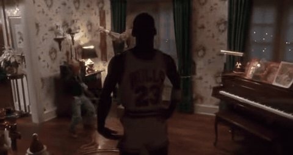</td>
<td width="38%"></td>
</tr><tr>
<td align="center"><sub>「나 홀로 집에」(1990) · 인형 · 장난감 기차 · 전축으로 혼자 집 전체 연출</sub></td>
<td align="center"><sub>요즘의 연출 · 기기마다 앱 · 손가락으로 정해진 그림 선택</sub></td>
</tr></table>

KEVIN은 이 두 장면 사이를 메웁니다. 앱 대신 말 한마디로, 새로 산 기기 대신 집에 있던 기기로.
<sub>참고 영상: [youtu.be/xOIHA3SSCvM](https://youtu.be/xOIHA3SSCvM) · [instagram.com/reel/Dd8vXumP7DU](https://www.instagram.com/reel/Dd8vXumP7DU/) · 사용 예시 참고용 발췌</sub>

### 실제 화면

<table><tr><td></td><td></td></tr><tr><td align="center"><sub>방을 서성이는 케빈</sub></td><td align="center"><sub>말을 걸면 대답하고 기기를 부림</sub></td></tr></table>

1. [웹](https://sergiobuilds.github.io/kevin/)을 엽니다. 90년대 도스 게임 같은 컬러 도트 방에서 케빈이 서성입니다.
2. 🎤로 말하거나 입력하면 케빈이 화면 가득 나와 목소리로 대답합니다.
3. “크리스마스로 만들어줘. 눈 펑펑, 캐럴도.” 장비가 설정·연결된 경우 → 133cm 전광판에 기차와 눈이 달리고, 낡은 라디오에서 캐럴이 나옵니다.
4. 같은 일을 다른 AI 에이전트가 실물 MCP로 부르고 카메라 촬영·서명까지 성공하면, 실행 전후 사진이 담긴 서명된 영수증이 돌아옵니다.

터미널에서는 `kevin --live`로 시작하고 **Space**로 말을 겁니다. 요청마다 **Ctrl+L**로 `LIVE` 표시를 확인한 뒤 제출합니다. 장비가 설정·연결되어 있어야 실물이 동작하며, 터미널 시연만으로는 서명된 영수증이 생성되지 않습니다.

## MCP로 부르기

```json
{
  "mcpServers": {
    "kevin": { "command": "python", "args": ["src/kevin_mcp.py"] }
  }
}
```

| 도구 | 하는 일 |
|---|---|
| `led_scene` | 전광판 장면(기차·산타), 눈, 하늘색, 속도 |
| `radio` | 라디오 캐럴 재생·정지, 볼륨 |
| `say` | 한국어·영어 문장 한 줄을 케빈이 계획해 실행 |
| `stop_all` | 모든 기기 즉시 정지 |

실물 MCP에서 촬영·서명이 성공한 영수증은 `.runtime/receipts/<id>/`에 사진과 함께 남고, 아래 명령으로 서명과 사진을 대조합니다.

```sh
python src/receipt.py .runtime/receipts/<id>
# OK 20261107-125914-35bb3d  changed=True (0.0704)  moving=True (0.1276)
```

## 실행

장비 없이 **조명·월패드·TV·IR·청소기의 통신과 상태 재조회**를 확인하는 확장 데모:

```sh
python3.11 -m venv .venv
.venv/bin/python -m pip install -r requirements-demo.txt
.venv/bin/python src/demo_server.py
# http://127.0.0.1:8790
```

세 구역 중 하나만 바꾸기, 어두움→조명→재관찰, 응답 무시·오래된 영상·켜졌지만 여전히 어두운 상황을 직접 실행합니다. 장치와 영상은 가상이며, 실제 `python-wled==1.1.1` 호출·전후 이미지·서명 검증을 사용합니다. 실물 연결 결과와 구분합니다. [시연 순서·실물 연결·재사용 출처](docs/HACKATHON_DEMO.md).

같은 화면 아래의 **04–07**에서 월패드 한 채널 제어, TV 앱 저장·전환·복귀, 적외선 코드 학습·전송, 청소기 지정 구역 시작·일시정지를 실행합니다. TV·IR은 실제 `adb-shell==0.4.4`와 `broadlink==0.19.0`이 loopback TCP/UDP 상대와 통신합니다. 월패드·청소기는 HA·Valetudo의 공개 HTTP API 일부를 구현한 가상 상대를 사용합니다. 모든 확장 결과는 `physically_verified=false`이며, TV 재생 위치 복원·실제 기차 코드·카메라 기반 오염 판단은 포함하지 않습니다.

04–07 도구만 MCP로 실행하려면 `.venv/bin/python src/device_demo_mcp.py`를 stdio 서버로 등록합니다. 이 진입점은 카메라·기존 실물 LED·라디오 설정을 사용하지 않습니다.

```sh
python3 -m venv .venv
.venv/bin/pip install -r requirements.txt
./kevin            # 미리보기: 기기를 건드리지 않습니다
```

실물 기기와 카메라 영수증은 Windows에서:

```powershell
py -m venv .venv
.venv\Scripts\pip install -r requirements-live.txt
$env:KEVIN_LED_ADDRESS  = "<전광판 BLE 주소>"
$env:KEVIN_RADIO_DEVICE = "CRF-35B"
$env:KEVIN_OLLAMA_MODEL = "qwen2.5:3b"
$env:KEVIN_CAMERA       = "0"            # 웹캠 번호, 끄려면 off
$env:KEVIN_CAMERA_ROI   = "x,y,w,h"      # 카메라 화면 속 기기 위치 (선택)
.\kevin.cmd --live
```

| 키 | 동작 |
|---|---|
| Space | 케빈에게 말 걸기 |
| Enter | 요청 보내기 |
| Ctrl+V | 음성 녹음 시작/끝 (`KEVIN_ASR_URL` 설정 시) |
| Ctrl+L | 이번 요청의 미리보기 ↔ 실물 전환. 제출 후 미리보기로 돌아감 |
| Esc | 모든 기기 정지 |

## AI 설정

케빈이 명령을 이해하는 방식을 선택하세요.

- **이 컴퓨터에서 실행** — Ollama에 설치된 로컬 모델을 사용합니다.
- **내 API 키로 연결** — 내 OpenAI API 키를 사용합니다. 사용량에 따라 API 요금이 발생합니다.

처음 실행할 때 설정하고, 이후에는 웹 상단의 **AI 설정** 또는 `./kevin --setup`에서 변경할 수 있습니다.
연결 확인은 고정된 시험 요청만 보내며 기기를 움직이지 않습니다. 웹·터미널·MCP `say`는 같은 설정을 사용합니다.
MCP의 직접 기기 도구는 내부 AI 설정 없이 사용할 수 있습니다. 음성·카메라는 별도 연결을 따릅니다.

[자세한 설정 안내](docs/AI_SETUP.md)

## 사용한 오픈소스와 기술

| 영역 | 사용 기술 |
|---|---|
| 에이전트 연결 | [Model Context Protocol](https://modelcontextprotocol.io) (stdio, JSON-RPC 2.0) |
| LED 전광판 | [pypixelcolor](https://github.com/lucagoc/pypixelcolor) 0.5.0, [Bleak](https://github.com/hbldh/bleak) / 참고: [go-ipxl](https://github.com/yyewolf/go-ipxl), [ha-ipixel-color](https://github.com/cagcoach/ha-ipixel-color) |
| 대화·판단 | AI 설정에서 Ollama 또는 OpenAI 선택(기본 모델 qwen2.5 3B / Luna), 카메라의 OpenAI 비전은 별도 연결 |
| 목소리 | ElevenLabs (eleven_multilingual_v2) |
| 영수증 | OpenCV 캡처, Pillow 전후 비교, [cryptography](https://cryptography.io) Ed25519 |
| 음성 | [faster-whisper](https://github.com/SYSTRAN/faster-whisper) (선택) |
| 라디오 | Windows Runtime `MediaPlayer` + 블루투스 오디오 장치 지정 |

## 테스트

```sh
PYTHONPATH=src python3 -m unittest discover -s tests
```

계획 해석, 단어 보정, 장면 렌더링, 전광판 전송, 취소·정지, MCP 서버, 영수증(변화·움직임 판정, 서명, 사진 바꿔치기와 값 조작 탐지)을 확인합니다. 실물 장치가 필요한 테스트는 장치가 없으면 건너뜁니다.

## 실물 동작 기록

| 기기 | 기록 |
|---|---|
| 디라이브 133×19.2cm LED 전광판 (144×16) | 행사장에서 한국어 문장 → 계획(약 1초) → 애니메이션 재생(전송 약 6초) 확인. 긴 GIF는 “받았다”고 대답하고도 첫 장면에서 멈춰, 12프레임 이하로 자동 조정 |
| 코비 CRF-35B 블루투스 라디오 | 캐럴 재생 청취 확인 (집). 행사장에서는 Windows 소리 출력 연결 대기 |
| 웹캠 영수증 | 가상 카메라로 서명·판정 확인. MSI 사용자 세션의 실물 웹캠 연결 진행 중 |
| MYKA FORT 90995 리모컨 기차 | 리모컨이 적외선 방식임을 확인. 적외선 송신 장치 연결 진행 중 |

## 로드맵 — 열한 가지 기기를 도구로

같은 세 층으로 확장할 11개 기기 트랙의 목표입니다. 아래 표는 현재 지원 목록이 아닙니다. 실물 기록은 LED·라디오, 가상 확장 데모는 조명·월패드·TV·IR·청소기이며 나머지 목표와의 차이는 로드맵에 적었습니다. 트랙별 시연, 출발점 오픈소스, 완료 기준은 [ROADMAP.md](ROADMAP.md)와 [이슈](https://github.com/sergiobuilds/kevin/issues?q=label%3Aroadmap)에 있습니다.

| # | 기기 | 에이전트가 할 수 있게 되는 일 |
|---|---|---|
| 01 | LED 전광판 | 장면·문구·애니메이션 바꾸기 **(실물 동작)** |
| 02 | 조명 | 카메라로 보고 구역별 밝기·위치 다시 맞추기 |
| 03 | 스피커·라디오 | 발표가 시작되면 음악을 말소리 아래로 |
| 04 | 월패드 | 다른 등은 그대로 두고 원하는 등만 |
| 05 | TV | 엉뚱한 화면을 보던 화면으로 되돌리기 |
| 06 | 적외선 가전 | 리모컨 신호를 배워 기차·선풍기 움직이기 |
| 07 | 로봇청소기 | 카메라로 본 남은 구역만 다시 청소 |
| 08 | 방범·현관 | 어두우면 불을 켜고 다시 보기 |
| 09 | 서비스 끝난 기기 | 서버가 사라진 기기 되살리기 |
| 10 | 모르는 통신법 | 설명서 없는 기기의 명령 뜻을 관찰로 배우기 |
| 11 | 가스·전기 차단 | 외출 중 켜진 가스·전기를 스스로 판단해 잠그고 끄기 |

## 사업성

에이전트가 웹을 넘어 실물을 다루기 시작하면, 기기 연결과 실제로 일어난 일의 기록이 반드시 필요해집니다. 연결 하나를 같은 기기를 가진 모든 고객과 에이전트가 다시 쓰므로, 동일 모델의 어댑터를 재사용할 수 있습니다. 새 기종 지원·설치·유지보수 비용과 지불 의사는 아직 검증하지 않았습니다. 고객층과 추산은 [BUSINESS.md](docs/BUSINESS.md)에 있습니다.

## 팀

OBA.RUN 2nd 해커톤 출품작입니다.
