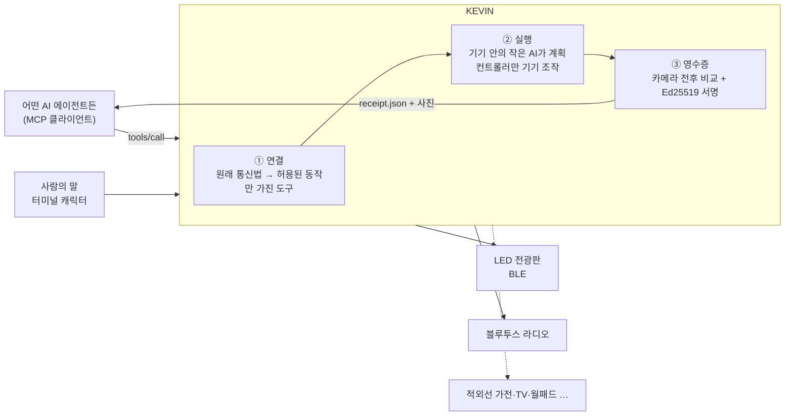
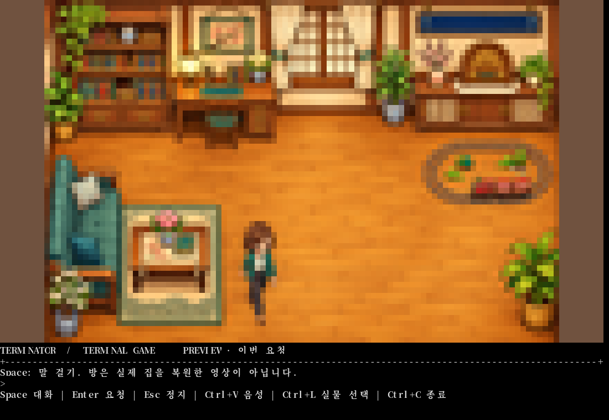
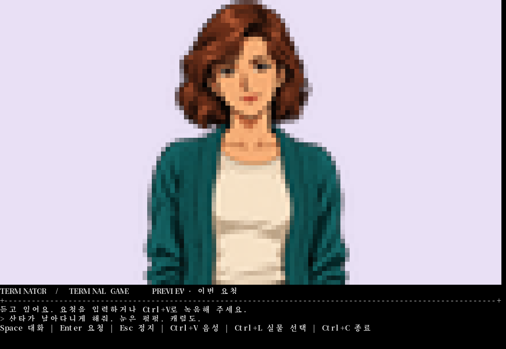

<div align="center">


### 어떤 기기든 AI가 부를 수 있는 도구로 바꿔 줍니다.<br>앱도, API도 없는 기기까지.

[로드맵](ROADMAP.md) · [사업성](docs/BUSINESS.md) · [브랜드](docs/BRAND.md) · [기여 안내](CONTRIBUTING.md)


<sub>KEVIN이 만든 144×16 프레임을 LED 점 모양으로 확대한 화면입니다.</sub>

</div>

---

## 제품과 검증 근거

[랜딩페이지 소스](docs/landing/index.html)에서 사용 장면과 실행 구조를, [기술 검증 문서](docs/TECHNICAL_EVIDENCE.md)에서 기능별 주장과 소스·검사·한계를 확인할 수 있습니다. [기계 판독용 근거](docs/landing/evidence.json)와 [텍스트 요약](docs/landing/llms.txt)도 같은 사실을 제공합니다. LED 실물 동작 이력, 로컬 프로토콜 데모, 구현과 향후 계획을 구분합니다.

## AI에게는 손이 없다

AI 에이전트는 웹과 API 앞에서는 무엇이든 합니다. 그런데 현실의 기기 대부분에는 API가 없습니다. 리모컨 하나로 움직이는 가전, 블루투스로만 말하는 간판, 벽 속의 월패드, 회사가 서버를 닫은 기기가 그렇습니다. 에이전트는 이 앞에서 멈춥니다.

**KEVIN은 AI가 세상의 옛날 기기를 직접 쓸 수 있게 해 주는 기기 연결 계층입니다.** 기기의 원래 통신법을 찾아 AI가 부를 수 있는 도구로 엽니다. 에이전트가 그 도구를 부르면, KEVIN은 기기를 움직이고 카메라로 실행 전후를 찍어 서명한 **실물 영수증**을 돌려줍니다.

## 기기의 대답과 실제 세상은 다르다

오늘 행사장에서 전광판은 32프레임 애니메이션을 “받았다”고 대답했습니다. 그런데 화면은 첫 장면에서 멈춰 있었습니다. 기기의 대답만 믿는 지금의 IoT와 에이전트 도구는 이런 실패를 모릅니다.

KEVIN은 기기의 대답 대신 **카메라가 본 변화**를 돌려줍니다. 화면이 바뀌었는지, 애니메이션이 실제로 움직이는지 숫자로 남기고, 사진과 함께 서명합니다. 다른 에이전트나 사람은 이 영수증 하나로 무슨 일이 실제로 일어났는지 확인할 수 있습니다.

## 세 층



| 층 | 하는 일 | 지금 |
|---|---|---|
| ① 연결 | 오픈소스와 신호에서 기기의 통신법을 찾아, AI가 바꿀 수 있는 항목만 가진 MCP 도구로 엽니다. 선언하지 않은 동작은 기기에 닿지 않습니다. | LED 전광판·라디오 도구 동작. MCP 서버 `src/kevin_mcp.py` |
| ② 실행 | 노트북 안의 3B 모델이 말을 0.5초 안에 계획으로 바꾸고, 문장에 실제로 나온 단어로 보정합니다. 인터넷 없이 돕니다. 새 요청이나 Esc가 오면 즉시 멈춥니다. | 행사장에서 전광판 실물 동작 |
| ③ 영수증 | 실행 전 1장, 후 2장을 찍어 바뀐 정도와 움직임을 재고, 계획·기기 응답·사진 해시를 묶어 Ed25519로 서명합니다. 사진을 바꿔치기하거나 값을 고치면 바로 드러납니다. | 구현·테스트 완료. 실물 웹캠 연결 진행 중 |

## 기반 기술인 이유

연결 하나를 만들면 **같은 기기를 가진 모든 사람과, MCP를 쓰는 모든 에이전트가** 다시 씁니다. 기기 종류가 늘수록 에이전트가 할 수 있는 일이 늘어납니다. KEVIN은 앱 하나가 아니라, 에이전트가 물리 세계로 나가는 길목에 놓이는 계층입니다.

## 시키지 않아도, 케빈이 스스로

케빈은 웹캠으로 방을 보고 1초마다 스스로 판단합니다. 기기 안의 작은 AI가 상황을 추론해 무엇을 할지 고르고, 규칙이 마지막으로 확인해 엉뚱한 경보나 꺼짐은 막습니다.

| 모드 | 케빈이 보는 것 | 케빈이 하는 일 |
|---|---|---|
| 🏠 집을 비웠을 때 (`--mode away`) | 사람이나 큰 움직임이 두 번 연속 잡힘 | 「나 홀로 집에」처럼: 전광판에 빨간 “누구야?! · 경찰 신고” 경고, 라디오 최대 음량, 케빈 목소리로 “누구세요? 지금 경찰에 신고했어요!” 그리고 실행 전후 사진이 담긴 실물 실행 증명을 남김 |
| 💡 집에 있을 때 (`--mode home`) | 정한 시간 동안 아무도 안 보임 | “한동안 아무도 없어서 전광판이랑 라디오 껐어.” 켜진 기기를 스스로 끔 |
| 🔥 가스·전기 (로드맵 11) | 외출 중 켜진 가스레인지·멀티탭 | 가스 밸브 잠금, 멀티탭 차단. 판단과 연결 지점은 같고, 잠금 장치 연결은 진행 중 |

<p align="center"></p>

```sh
python src/guardian.py --mode away              # 집을 비웠을 때
python src/guardian.py --mode home --idle 300   # 5분 동안 아무도 없으면 끄기
```

## 시연

### 사용 예시 · 케빈이 하려는 일

<table><tr>
<td width="62%"></td>
<td width="38%"></td>
</tr><tr>
<td align="center"><sub>「나 홀로 집에」(1990) · 인형 · 장난감 기차 · 전축으로 혼자 집 전체 연출</sub></td>
<td align="center"><sub>요즘의 연출 · 기기마다 앱 · 손가락으로 정해진 그림 선택</sub></td>
</tr></table>

KEVIN은 이 두 장면 사이를 메웁니다. 앱 대신 말 한마디로, 새로 산 기기 대신 집에 있던 기기로.
<sub>참고 영상: [youtu.be/xOIHA3SSCvM](https://youtu.be/xOIHA3SSCvM) · [instagram.com/reel/Dd8vXumP7DU](https://www.instagram.com/reel/Dd8vXumP7DU/) · 사용 예시 참고용 발췌</sub>

### 실제 화면

<table><tr><td></td><td></td></tr><tr><td align="center"><sub>방을 서성이는 케빈</sub></td><td align="center"><sub>말을 걸면 다가와 듣는다</sub></td></tr></table>

1. 터미널에서 `kevin --live`. 90년대 도스 게임 같은 컬러 도트 방에서 케빈이 서성입니다.
2. **Space**로 말을 걸면 배경이 사라지고 케빈이 화면 가득 다가옵니다.
3. “크리스마스로 만들어줘. 눈 펑펑, 캐럴도.” → 133cm 전광판에 기차와 눈이 달리고, 낡은 라디오에서 캐럴이 나옵니다.
4. 같은 일을 다른 AI 에이전트가 MCP로 부르면, 실행 전후 사진이 담긴 서명된 영수증이 돌아옵니다.

## MCP로 부르기

```json
{
  "mcpServers": {
    "kevin": { "command": "python", "args": ["src/kevin_mcp.py"] }
  }
}
```

| 도구 | 하는 일 |
|---|---|
| `led_scene` | 전광판 장면(기차·산타), 눈, 하늘색, 속도 |
| `radio` | 라디오 캐럴 재생·정지, 볼륨 |
| `say` | 한국어·영어 문장 한 줄을 케빈이 계획해 실행 |
| `stop_all` | 모든 기기 즉시 정지 |

영수증은 `.runtime/receipts/<id>/`에 사진과 함께 남고, 아래 명령으로 서명과 사진을 대조합니다.

```sh
python src/receipt.py .runtime/receipts/<id>
# OK 20261107-125914-35bb3d  changed=True (0.0704)  moving=True (0.1276)
```

## 실행

장비 없이 **조명·월패드·TV·IR·청소기의 통신과 상태 재조회**를 확인하는 확장 데모:

```sh
python3.11 -m venv .venv
.venv/bin/python -m pip install -r requirements-demo.txt
.venv/bin/python src/demo_server.py
# http://127.0.0.1:8790
```

세 구역 중 하나만 바꾸기, 어두움→조명→재관찰, 응답 무시·오래된 영상·켜졌지만 여전히 어두운 상황을 직접 실행합니다. 장치와 영상은 가상이며, 실제 `python-wled==1.1.1` 호출·전후 이미지·서명 검증을 사용합니다. 실물 연결 결과와 구분합니다. [시연 순서·실물 연결·재사용 출처](docs/HACKATHON_DEMO.md).

같은 화면 아래의 **04–07**에서 월패드 한 채널 제어, TV 앱 저장·전환·복귀, 적외선 코드 학습·전송, 청소기 지정 구역 시작·일시정지를 실행합니다. TV·IR은 실제 `adb-shell==0.4.4`와 `broadlink==0.19.0`이 loopback TCP/UDP 상대와 통신합니다. 월패드·청소기는 HA·Valetudo의 공개 HTTP API 일부를 구현한 가상 상대를 사용합니다. 모든 확장 결과는 `physically_verified=false`이며, TV 재생 위치 복원·실제 기차 코드·카메라 기반 오염 판단은 포함하지 않습니다.

04–07 도구만 MCP로 실행하려면 `.venv/bin/python src/device_demo_mcp.py`를 stdio 서버로 등록합니다. 이 진입점은 카메라·기존 실물 LED·라디오 설정을 사용하지 않습니다.

```sh
python3 -m venv .venv
.venv/bin/pip install -r requirements.txt
./kevin            # 미리보기: 기기를 건드리지 않습니다
```

실물 기기와 카메라 영수증은 Windows에서:

```powershell
py -m venv .venv
.venv\Scripts\pip install -r requirements-live.txt
$env:KEVIN_LED_ADDRESS  = "<전광판 BLE 주소>"
$env:KEVIN_RADIO_DEVICE = "CRF-35B"
$env:KEVIN_OLLAMA_MODEL = "qwen2.5:3b"
$env:KEVIN_CAMERA       = "0"            # 웹캠 번호, 끄려면 off
$env:KEVIN_CAMERA_ROI   = "x,y,w,h"      # 카메라 화면 속 기기 위치 (선택)
.\kevin.cmd --live
```

| 키 | 동작 |
|---|---|
| Space | 케빈에게 말 걸기 |
| Enter | 요청 보내기 |
| Ctrl+V | 음성 녹음 시작/끝 (`KEVIN_ASR_URL` 설정 시) |
| Ctrl+L | 미리보기 ↔ 실물 전환 |
| Esc | 모든 기기 정지 |

## 선택 옵션: OpenAI Luna

기본은 기존 로컬 Ollama입니다. `OPENAI_API_KEY`를 실행 환경에 설정한 뒤 명시적으로 선택하면
OpenAI API의 `gpt-6-luna`가 같은 연출 계획을 만듭니다. 추가 Python 패키지는 필요 없습니다.

```sh
./kevin --planner openai
# Windows: .\kevin.cmd --planner openai
```

`KEVIN_PLANNER=openai` 환경변수로도 선택할 수 있어 MCP의 `say`에도 적용됩니다.
CLI의 `--planner`가 환경변수보다 우선하며, 키가 있다는 이유로 자동 전환하지 않습니다.
이 선택은 터미널과 MCP `say`에 적용됩니다. 웹 브리지와 지킴이 모드는 각각 기존 모델 선택을 사용합니다.
선택 설정은 `KEVIN_OPENAI_MODEL`(기본 `gpt-6-luna`),
`KEVIN_OPENAI_TIMEOUT`(기본 30초, 최대 120초)입니다.
모델 선택은 실물 실행 선택과 독립적입니다. `--live`와 기존 장비 설정은 그대로 필요합니다.

OpenAI를 선택하면 요청 텍스트와 현재 연출 설정이 외부 API로 전송됩니다.
키·장비 주소·음성 파일은 계획 본문에 넣지 않습니다. API 키는 프로세스 환경에만 두고 커밋하지 마세요.
Responses API에 `store:false`를 보내지만 기본 모니터링 로그까지 비활성화하는 옵션은 아닙니다.
API 키 오류·거절·시간 초과·불완전한 계획에는 실행하지 않으며 다른 모델로 자동 재시도하지 않습니다.
Luna 응답은 로컬 스키마 검증을 거쳐 기존 컨트롤러로 전달합니다.

참고: [Luna 모델](https://developers.openai.com/api/docs/models/gpt-6-luna),
[구조화 출력](https://developers.openai.com/api/docs/guides/structured-outputs?api-mode=responses),
[API 데이터 정책](https://developers.openai.com/api/docs/guides/your-data).

## 사용한 오픈소스와 기술

| 영역 | 사용 기술 |
|---|---|
| 에이전트 연결 | [Model Context Protocol](https://modelcontextprotocol.io) (stdio, JSON-RPC 2.0) |
| LED 전광판 | [pypixelcolor](https://github.com/lucagoc/pypixelcolor) 0.5.0, [Bleak](https://github.com/hbldh/bleak) / 참고: [go-ipxl](https://github.com/yyewolf/go-ipxl), [ha-ipixel-color](https://github.com/cagcoach/ha-ipixel-color) |
| 계획 | [Ollama](https://ollama.com) + qwen2.5 3B, JSON Schema 구조화 출력 + 단어 보정 |
| 영수증 | OpenCV 캡처, Pillow 전후 비교, [cryptography](https://cryptography.io) Ed25519 |
| 음성 | [faster-whisper](https://github.com/SYSTRAN/faster-whisper) (선택) |
| 라디오 | Windows Runtime `MediaPlayer` + 블루투스 오디오 장치 지정 |

## 테스트

```sh
PYTHONPATH=src python3 -m unittest discover -s tests
```

계획 해석, 단어 보정, 장면 렌더링, 전광판 전송, 취소·정지, MCP 서버, 영수증(변화·움직임 판정, 서명, 사진 바꿔치기와 값 조작 탐지)을 확인합니다. 실물 장치가 필요한 테스트는 장치가 없으면 건너뜁니다.

## 실물 동작 기록

| 기기 | 기록 |
|---|---|
| 디라이브 133×19.2cm LED 전광판 (144×16) | 행사장에서 한국어 문장 → 계획(약 1초) → 애니메이션 재생(전송 약 6초) 확인. 긴 GIF는 “받았다”고 대답하고도 첫 장면에서 멈춰, 12프레임 이하로 자동 조정 |
| 코비 CRF-35B 블루투스 라디오 | 캐럴 재생 청취 확인 (집). 행사장에서는 Windows 소리 출력 연결 대기 |
| 웹캠 영수증 | 가상 카메라로 서명·판정 확인. MSI 사용자 세션의 실물 웹캠 연결 진행 중 |
| MYKA FORT 90995 리모컨 기차 | 리모컨이 적외선 방식임을 확인. 적외선 송신 장치 연결 진행 중 |

## 로드맵 — 열 가지 기기를 도구로

같은 세 층으로 11개 기기 트랙을 팀원이 동시에 엽니다. 트랙별 시연, 출발점 오픈소스, 완료 기준은 [ROADMAP.md](ROADMAP.md)와 [이슈](https://github.com/sergiobuilds/kevin/issues?q=label%3Aroadmap)에 있습니다.

| # | 기기 | 에이전트가 할 수 있게 되는 일 |
|---|---|---|
| 01 | LED 전광판 | 장면·문구·애니메이션 바꾸기 **(실물 동작)** |
| 02 | 조명 | 카메라로 보고 구역별 밝기·위치 다시 맞추기 |
| 03 | 스피커·라디오 | 발표가 시작되면 음악을 말소리 아래로 |
| 04 | 월패드 | 다른 등은 그대로 두고 원하는 등만 |
| 05 | TV | 엉뚱한 화면을 보던 화면으로 되돌리기 |
| 06 | 적외선 가전 | 리모컨 신호를 배워 기차·선풍기 움직이기 |
| 07 | 로봇청소기 | 카메라로 본 남은 구역만 다시 청소 |
| 08 | 방범·현관 | 어두우면 불을 켜고 다시 보기 |
| 09 | 서비스 끝난 기기 | 서버가 사라진 기기 되살리기 |
| 10 | 모르는 통신법 | 설명서 없는 기기의 명령 뜻을 관찰로 배우기 |
| 11 | 가스·전기 차단 | 외출 중 켜진 가스·전기를 스스로 판단해 잠그고 끄기 |

## 사업성

에이전트가 웹을 넘어 실물을 다루기 시작하면, 기기 연결과 실제로 일어난 일의 기록이 반드시 필요해집니다. 연결 하나를 같은 기기를 가진 모든 고객과 에이전트가 다시 쓰므로, 기기 종류가 늘수록 비용은 그대로이고 쓰임은 커집니다. 고객층과 추산은 [BUSINESS.md](docs/BUSINESS.md)에 있습니다.

## 팀

OBA.RUN 2nd 해커톤 출품작입니다.
