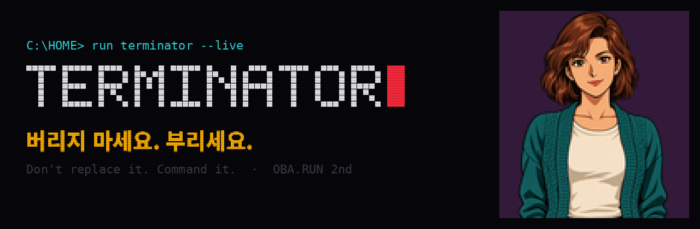

# Brand — TERMINATOR

## 이름

**TERMINATOR = TERMINAL + 끝내는 자.** 터미널 안에 사는 AI가, 앱이 없다는 이유로 버려질 운명인 옛날 기기들의 “단종”을 끝냅니다.

## 한 줄

- **버리지 마세요. 부리세요.**
- Don't replace it. Command it.
- 보조: *I'll be back — 당신의 옛날 기기도.*

## 약속

1. **새로 사지 않는다.** 이미 집에 있는 기기를 그 기기의 원래 통신법으로 부린다.
2. **앱도, 클라우드도 없이.** 말과 기기 사이에 제조사 서버를 두지 않는다.
3. **말 한마디에 실물이 바뀐다.** 대시보드 대신 대화, 미리보기 대신 실제 화면과 소리.

## 시각 언어

90년대 도스 게임과 미연시의 컬러 도트. 고화질 대신 신비감이 있는 픽셀, 둥근 홀로그램 대신 사람 같은 캐릭터.

| 역할 | 색 | 값 |
|---|---|---|
| 배경 (꺼진 CRT) |  | `#07070B` |
| 커서·경고 (터미네이터의 눈) |  | `#FF2A3D` |
| 한 줄 메시지 (앰버 모니터) |  | `#FFB000` |
| 프롬프트 (도스 시안) |  | `#2DE2E6` |
| 캐릭터 배경 (미연시 보라) |  | `#341A3A` |

- 워드마크는 5×7 도트 글자 `TERMINATOR` 뒤에 빨간 블록 커서 ▌를 붙입니다.
- 화면에는 가는 주사선(scanline)을 깔아 CRT 느낌을 냅니다.
- 캐릭터는 굵은 선의 셀화풍 컬러 여성. 방을 서성이다 말을 걸면 배경이 사라지고 크게 다가옵니다.

## 말투

- 캐릭터: 짧고 친근하게. “기차 더 빨리? 좋아, 지금 올릴게.”
- 시스템: 대문자·짧게. `LIVE`, `PREVIEW`, `STOP`.
- 하지 않은 일을 했다고 말하지 않습니다. 전송 확인과 눈으로 본 결과를 구분합니다.

## 시연 오프닝 (15초)

> 화면이 꺼진 CRT처럼 검다. `C:\HOME> run terminator --live` 가 찍히고 빨간 커서가 깜빡인다.
> 방을 서성이던 캐릭터에게 말을 건다. “크리스마스로 만들어줘.”
> 133cm 전광판에 산타가 날고, 낡은 라디오에서 캐럴이 흐른다.
> **버리지 마세요. 부리세요.**
