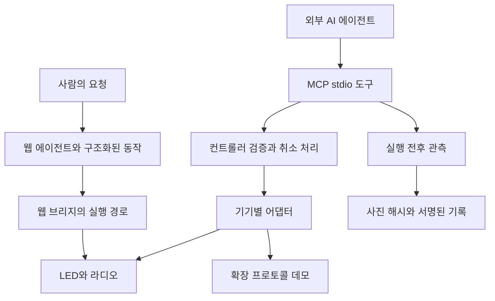

# KEVIN 기술과 검증 근거

KEVIN은 지원하는 기존 기기를 AI가 호출할 수 있는 도구로 연결하고, 기기 응답과 실행 뒤 관측을 구분하는 실물 실행 계층 프로토타입입니다. 사용자는 캐릭터와 대화하고, 다른 에이전트는 MCP 도구를 호출합니다. 기기 연결과 관측 기록은 같은 기반으로 재사용하려는 대상이며, 모든 기기·모든 요청에 대한 범용 제어가 완성됐다는 뜻은 아닙니다.

이 문서는 2026-11-07의 소스 `ab0a856`을 기준으로 작성했습니다. [랜딩페이지](landing/index.html), [구조화된 기능별 근거](landing/evidence.json), [AI가 읽을 수 있는 요약](landing/llms.txt)에서 같은 범위의 사실을 제공합니다. 실물 이력은 운영자·사용자 확인 기록이며, 이 문서를 작성하면서 새로 독립 측정한 결과와 구분합니다.

## 해결하는 문제

AI가 자연어를 이해해도 기기에 API가 없으면 실행할 통로가 없습니다. 연결 통로를 확보한 뒤에도 기기의 수신 응답만으로 실제 작동을 판단할 수 없습니다. 행사장에서 LED가 32프레임 GIF를 받았다고 응답했지만 첫 프레임에서 멈춘 사례가 있었습니다. 현재 전송 경로는 장면 프레임 수를 줄여 호환 문제에 대응합니다. 이 사례가 임의 기기에서의 자동 실패 복구를 입증하지는 않습니다.

KEVIN은 이 두 문제에 대응하도록 기기 도구와 관측 기록을 함께 설계했습니다. 기존 프로토콜 구현을 재사용해 기기별 허용 동작을 노출하고, 사진으로 확인한 변화와 기기 자체 응답을 별도 필드에 남깁니다.

## 실행 구조



웹 브리지와 MCP는 서로 다른 진입 경로입니다. MCP·컨트롤러의 카메라 영수증 구현을 근거로 모든 웹 대화가 서명된 실물 증거를 돌려준다고 주장하지 않습니다. 확장 프로토콜 데모도 기존 웹 자연어 플래너의 자동 기기 선택과 구분합니다.

| 설계 | 구현 근거 | 확인할 수 있는 차이 |
|---|---|---|
| 모델의 선택과 실행 코드 분리 | [웹 에이전트](https://github.com/sergiobuilds/kevin/blob/ab0a856/src/kevin_agent.py), [컨트롤러](https://github.com/sergiobuilds/kevin/blob/ab0a856/src/show_control.py), [MCP](https://github.com/sergiobuilds/kevin/blob/ab0a856/src/kevin_mcp.py) | JSON Schema와 열거형으로 동작을 표현하고, 실행 경계에서 검증합니다. 모델이 임의 코드를 실행하는 구조가 아닙니다. |
| 기기별 동작·상태 분리 | [컨트롤러 검사](https://github.com/sergiobuilds/kevin/blob/ab0a856/tests/test_show_control.py) | LED 변경이 라디오를 다시 재생하지 않는지, 미리보기 상태가 실물 실행에 섞이지 않는지 검사합니다. |
| 취소와 늦은 결과 처리 | [MCP 검사](https://github.com/sergiobuilds/kevin/blob/ab0a856/tests/test_kevin_mcp.py), [데모 서버 검사](https://github.com/sergiobuilds/kevin/blob/ab0a856/tests/test_demo_server.py) | 정지 뒤 늦게 도착한 관측이 성공 결과를 덮어쓰지 않는지 검사합니다. 웹 브리지에도 이전 요청 취소 경로가 있습니다. |
| 응답과 관측 분리 | [관측·영수증 구현](https://github.com/sergiobuilds/kevin/blob/ab0a856/src/receipt.py) | 수신 응답, 영상 변화, 움직임을 서로 다른 값으로 보존합니다. |
| 사진과 기록의 무결성 | [서명 검사](https://github.com/sergiobuilds/kevin/blob/ab0a856/tests/test_receipt.py) | 사진 교체, 관측값 변경, 파일 누락·추가, 출처 변경을 탐지합니다. |
| 모델 판단과 규칙 판정 분리 | [게임 판정](https://github.com/sergiobuilds/kevin/blob/ab0a856/src/kevin_agent.py) | 가위바위보 승패·점수는 Python 규칙으로 계산합니다. 다른 게임의 모든 정답까지 결정론적으로 검증한다는 뜻은 아닙니다. |

## 관측과 서명의 범위

`receipt.observe()`는 선택한 관심 영역을 회색조로 바꾸고 320×180으로 조정한 뒤 블러를 적용합니다. 밝기 차이가 24 이상인 픽셀 비율을 계산해 실행 전후 변화와 실행 후 프레임 사이 움직임을 구분합니다. 기본 판단값은 변화 비율 0.02, 움직임 비율 0.004입니다. 이 숫자는 휴리스틱 임곗값이며 인식 정확도·성공률·신뢰도 점수가 아닙니다.

관측에는 `source`와 `scope=visual_change_only`를 기록합니다. 관심 영역 밖의 움직임을 제외하는 검사와 잘못된 영역·이미지를 거절하는 검사가 있습니다. 그래도 카메라 흔들림, 노출 변화, 가림, 대상 내부의 무관한 변화가 판정에 영향을 줄 수 있습니다. 실제 요청의 의미가 달성됐는지는 기기와 작업에 맞춘 추가 확인이 필요합니다. 영상만으로 라디오 소리가 들렸는지 증명하지 않습니다.

사진은 SHA-256으로 해시하고, 계획·기기 응답·관측·사진 해시를 정규화한 JSON에 Ed25519 서명을 붙입니다. `receipt.check()`는 서명을 확인하며 사진까지 제공하면 전체 파일 집합과 해시를 대조합니다. 이미지 없이 실행한 검사는 서명된 명세만 확인합니다.

**서명은 기록의 무결성을 확인합니다.** 카메라가 진짜 현장을 촬영했는지, 서명자가 신뢰할 수 있는 주체인지, 작업이 의도대로 성공했는지를 보증하지 않습니다. 현재 검증기는 기록에 포함된 공개키를 사용하므로 외부 신뢰키에 대한 신원 인증도 별도입니다.

## 기능별 확인 범위

| 대상 | 근거의 종류 | 확인한 범위 | 남은 검증 |
|---|---|---|---|
| 디라이브 144×16 LED | 실물 동작 이력 | BLE 연결·전송·애니메이션 재생 확인 기록 | 최신 자유 문구·점수판 등을 포함한 반복 현장 검증 |
| 코비 CRF-35B | 집에서 청취한 이력 | 캐럴 재생·출력 확인 기록 | 행사장 출력 연결과 통합 청취·정지 |
| 카메라 영수증 | 이번 테스트 재실행 | 합성 이미지·모의 카메라의 관측과 무결성 | 현장 작업 의미에 대한 성공 판정 |
| WLED | loopback 프로토콜 데모 | 실제 python-wled 클라이언트, 지정 구역 요청·상태 재조회 | 펌웨어·실물 조명 검증 |
| Home Assistant 조명 | API 부분 구현과 loopback | 지정 entity, 상태 신선도, 다른 채널 보존 | 실제 HA·월패드 연결 |
| TV | 실제 adb-shell과 TCP 테스트 상대 | 앱 상태 저장·전환·복귀 | 실제 Android TV, 재생 위치 복원 |
| 적외선 | 실제 python-broadlink와 UDP 테스트 상대 | 인증·암호화·합성 코드 학습·송신·정지 시도 | 실제 송신기·원리모컨·기차 이동·정지 |
| 청소기 | Valetudo API 부분 구현과 loopback | 지정 구역 요청·상태 재조회·일시정지 | 실물 청소기·지도 보정·청소 결과 |
| 대화·멜로디·게임 | 구현 소스 확인 | 최근 대화 입력, 문구·점수·음표 생성, 가위바위보 규칙 판정 | 각 시나리오의 실물·음향 검증 |

확장 트랙은 실제 클라이언트 또는 공개 API 형식으로 로컬 테스트 상대와 통신합니다. HA·Valetudo 서버나 Android OS·Broadlink 펌웨어를 그대로 실행한 결과가 아닙니다. 합성 IR 코드는 실물 기차용 코드가 아닙니다. 확장 결과의 `physically_verified=false`와 IR의 `sent_unverified`를 유지합니다. 출발 뒤 정지 명령을 보냈다는 사실도 실제 모터 정지를 보증하지 않습니다.

## 재현

기기·모델 API 없이 확장 데모를 실행할 수 있습니다. [상세 실행 안내](HACKATHON_DEMO.md)에 환경과 동작 범위를 정리했습니다.

```sh
git clone https://github.com/sergiobuilds/kevin.git
cd kevin
python3.11 -m venv .venv
.venv/bin/python -m pip install -r requirements-demo.txt
.venv/bin/python src/demo_server.py
# 브라우저에서 http://127.0.0.1:8790
```

서버는 자체 loopback 테스트 상대를 사용합니다. 실물 환경 변수가 있어도 그 장치를 대신 조작하는 실물 데모로 해석하지 않습니다. 원격에 공개하지 않아도 로컬에서 실행할 수 있습니다.

MCP 클라이언트에는 기본 장치 도구용 `python src/kevin_mcp.py` 또는 확장 시뮬레이션용 `python src/device_demo_mcp.py`를 등록합니다. 기본 MCP의 실물 제어에는 장치 설정과 해당 실행 환경이 필요합니다. 확장 도구의 이름·인수는 [데모 문서](HACKATHON_DEMO.md#추가된-04–07-실행-경로)에서 확인합니다.

## 이번에 다시 확인한 검사

2026-11-07, 기준 소스 `ab0a856`에서 아래 명령을 실행했습니다. **21개 모두 통과했고 실패·생략은 없습니다.** 이는 관측·서명 관련 기존 테스트 결과이며 전체 제품·실물 장치·유료 모델 API 평가가 아닙니다.

```sh
PYTHONPATH=src python3 -m unittest discover -s tests -p test_receipt.py -v
```

검사에는 정지한 화면과 움직이는 화면의 구분, 관심 영역 밖 변화 제외, 잘못된 이미지 거절, 카메라 실패 뒤 재개, 서명 검증, 사진 교체·관측값 변경 탐지, 누락·추가 파일 거절, 합성 관측의 출처 변경 탐지가 포함됩니다. [기존 테스트 소스](https://github.com/sergiobuilds/kevin/blob/ab0a856/tests/test_receipt.py)에서 입력과 기대 결과를 확인할 수 있습니다.

확장 프로토콜·취소·장치 상태 관련 테스트 소스도 저장소에 있습니다. 이 문서 작성 중 그 전체 묶음을 재실행했다고 주장하지 않습니다. 과거 PR의 검사 수와 이번 검사 수를 합쳐 새로운 제품 성공률을 만들지 않습니다.

## 재사용과 확장

KEVIN은 MCP 연결, 허용된 기기 동작, 제어와 관측 기록을 결합합니다. 프로토콜은 pypixelcolor·Bleak, python-wled, adb-shell, python-broadlink 등 기존 구현을 활용합니다. 개별 프로토콜이나 Ed25519를 새로 발명했다는 주장이 아닙니다. 연결 하나를 여러 에이전트가 재사용하고, 기기 응답과 관측을 구분해서 돌려주는 구조가 제품의 설계 방향입니다.

오픈소스별 역할·라이선스·연결 조건은 [README](https://github.com/sergiobuilds/kevin/blob/ab0a856/README.md), [확장 데모](HACKATHON_DEMO.md), [TV](TRACK_05_TV.md), [IR](TRACK_06_IR.md), [HA·Valetudo](TRACKS_04_07.md)에 있습니다. KEVIN 자체 라이선스는 [MIT](https://github.com/sergiobuilds/kevin/blob/ab0a856/LICENSE)입니다.

에이전트 플랫폼의 기기 도구 팩, 매장의 기존 간판·오디오 제어, 기존 설비 연결은 확장 가능한 사용처로 검토하고 있습니다. 유료 고객·계약·매출·기기별 유지보수 비용을 검증한 상태는 아닙니다. 미지 통신 규격의 자율 발견, 모든 기기의 즉석 학습, 범용 실물 실패 복구도 현재 완료 범위에 포함하지 않습니다.
